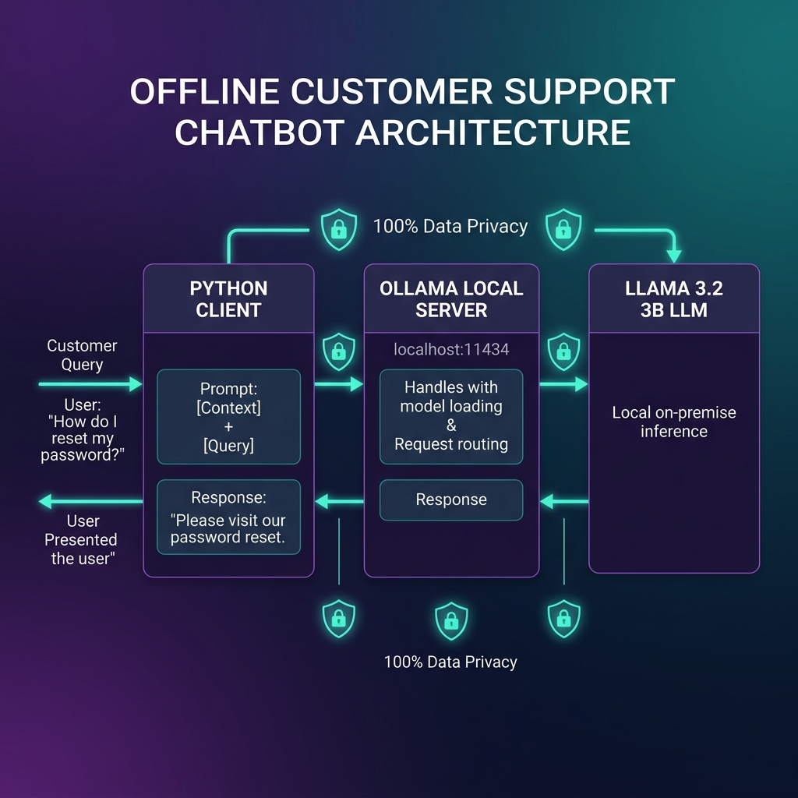
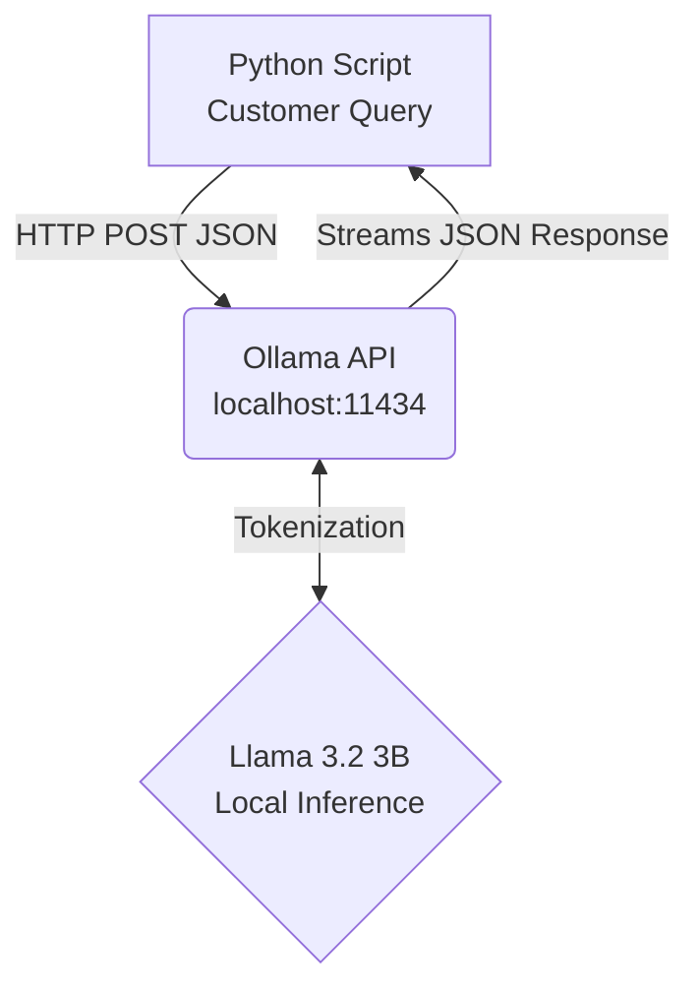
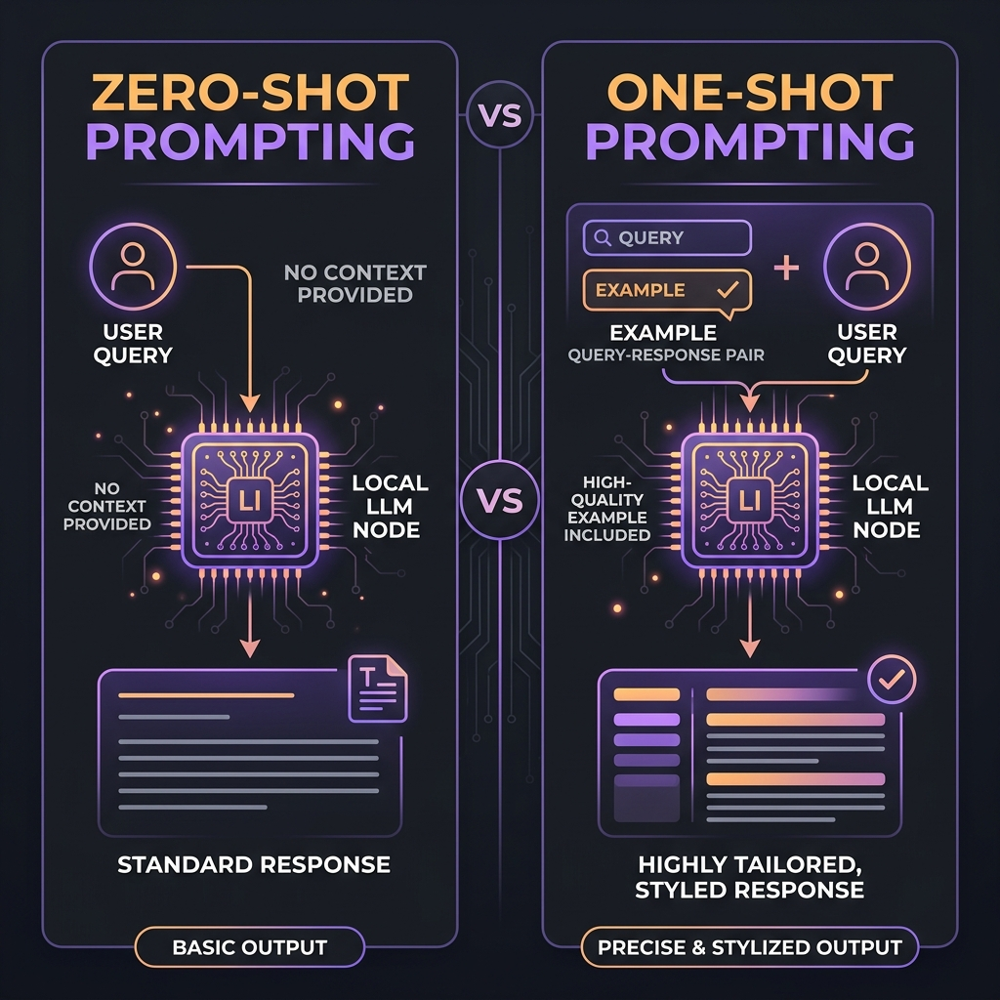
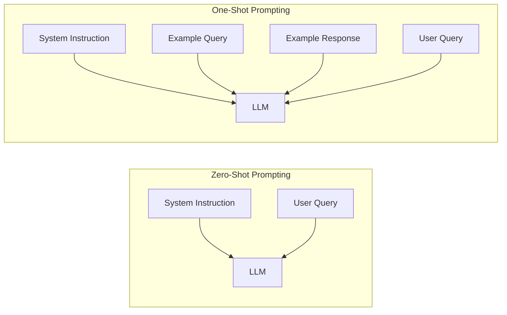
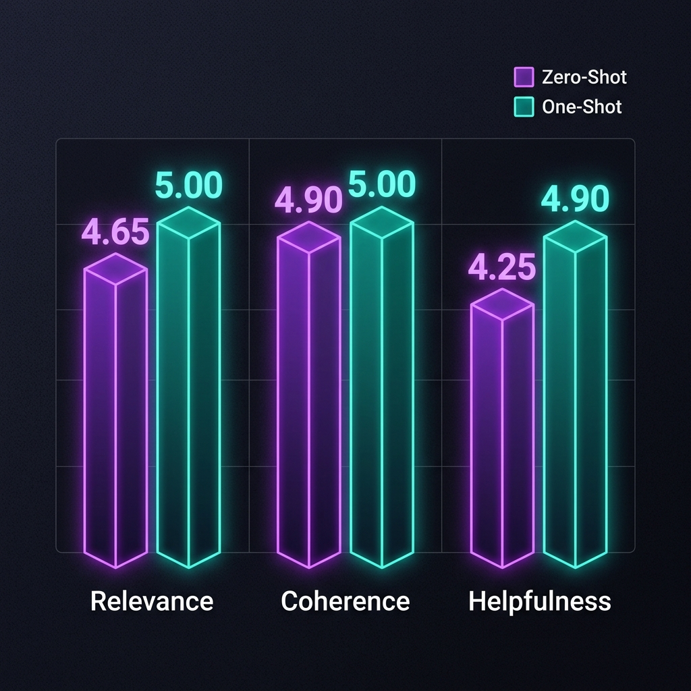

# Offline Customer Support Chatbot

A privacy-first e-commerce chatbot built using Ollama and Llama 3.2 3B. This project demonstrates local LLM deployment, prompt engineering (Zero-Shot vs. One-Shot), and performance evaluation.

> [!NOTE]
> ### 💡 Why Visuals Matter in this Walkthrough
> When presenting a local machine learning system, scrolling through raw code or text files in an editor is rarely enough to grasp the full runtime dynamics. For example:
> * **Code Limitations**: Looking at a raw `requests.post()` inside `chatbot.py` does not show you how the Python script, the local Ollama daemon, and Llama 3.2's neural network interact in real-time. Our [System Architecture Diagram](#🏗️-high-level-architecture--flow) makes this relationship instantly clear.
> * **Abstract Logic**: Reading template string substitutions under `prompts/` cannot easily show the cognitive difference in LLM reasoning between Zero-Shot direct questions and One-Shot in-context examples. Our [Prompting Concepts Diagram](#🧠-prompt-engineering-concepts) maps this comparison side-by-side.
> * **Data Scaling**: Scrolling through 40 rows of raw markdown tables in `eval/results.md` doesn't instantly show which technique actually performed better. Our [Performance Chart](#📊-performance-comparison) makes the quantitative comparison immediately visual.
> 
> By integrating these high-fidelity visual guides directly into the README, we bridge the gap between static code and dynamic runtime behaviors, ensuring a presentation that is highly clear, professional, and easy to follow.

## 🏗️ High-Level Architecture & Flow

  

Our stateless architecture keeps the application lightweight:
- **Python Script (Client)**: Formats prompts and executes synchronous HTTP POST requests.
- **Ollama API**: Manages hardware allocation and model serving.
- **Llama 3.2 (3B)**: Performs local inference, guaranteeing total data privacy.

## 🧠 Prompt Engineering Concepts

  

- **Zero-Shot Prompting**: Direct instruction. The model relies entirely on its pre-trained weights.
- **One-Shot Prompting**: We provide exactly one high-quality example of a query and response. This context primes the model to output the correct tone, structure, and brevity.

## 📊 Performance Comparison

  

| Metric (1-5 Scale) | Zero-Shot | One-Shot | Qualitative Impact |
| :--- | :---: | :---: | :--- |
| **Relevance** | 4.65 | **5.00** | One-Shot context provides tighter alignment to specific e-commerce issues. |
| **Coherence** | 4.90 | **5.00** | One-Shot perfectly matches the desired professional persona. |
| **Helpfulness** | 4.25 | **4.90** | Zero-Shot occasionally hallucinates filler; One-Shot is strictly concise. |

- **Formatting Stability**: The One-Shot template ensured the model adhered strictly to formatting constraints, preventing Markdown-breaking syntax.

## 🚀 Project Structure
- `chatbot.py`: Main script to interact with the Ollama API.
- `prompts/`: Contains isolated template text files.
- `eval/`: Automated markdown reports (`results.md`).
- `setup.md`: Detailed setup instructions.
- `report.md`: Detailed qualitative and quantitative analysis.

## 🛡️ Why Local LLMs? (Cloud vs. Local)

| Feature | Cloud LLMs (e.g., OpenAI) | Local LLMs (Ollama + Llama 3.2) |
| :--- | :--- | :--- |
| **Data Privacy** | High Risk (Data leaves network) | **100% Secure** (Air-gapped) |
| **Cost** | Pay per token (Recurring) | **Free** (Zero API costs) |
| **Latency** | Network dependent | **Hardware dependent** (Fast) |
| **Control** | Subject to provider updates | **Full control** over weights & prompt |

## License
MIT
